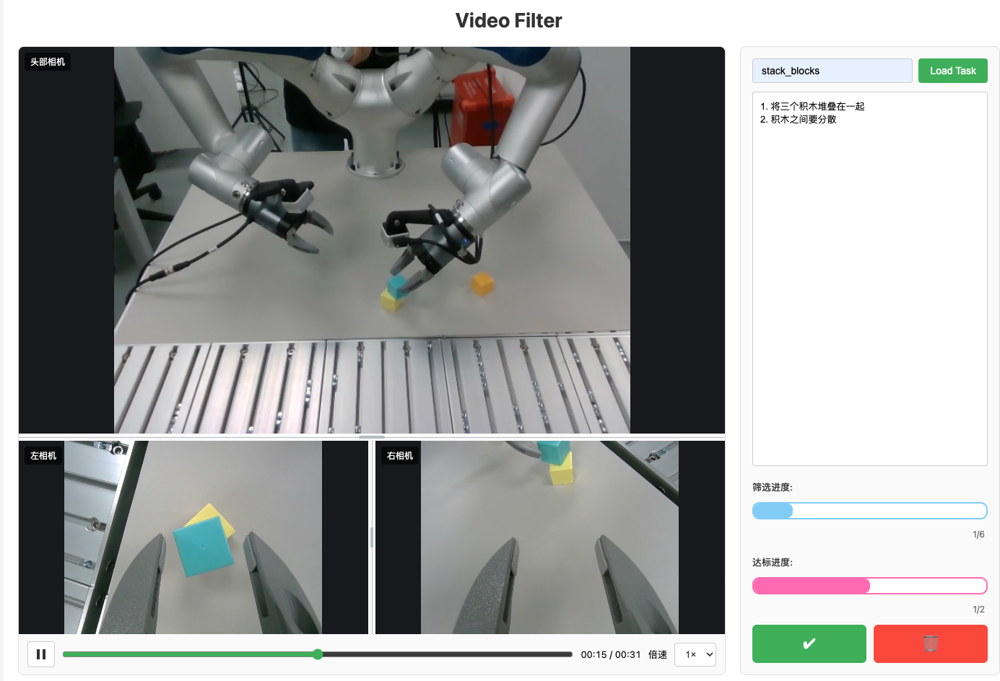

# Video Filter



基于 Flask 的三路相机视频筛选工具，通过浏览器访问,用于筛选视频数据。一个轨迹目录是一条筛选记录，三路视频共同接受或拒绝。

## Installation

先安装 [uv](https://docs.astral.sh/uv/getting-started/installation/)，然后在项目根目录安装依赖：

```bash
uv sync
```

`uv sync` 会自动创建 `.venv` 虚拟环境并安装项目依赖。

## Get Start

在仓库根目录启动：

```bash
uv run python -m video_filter
```

也可以使用以下命令启动：

```bash
uv run video-filter
```

默认监听端口为 `8888`。

在浏览器打开 <http://127.0.0.1:8888>，输入任务名字，点击 `Load Task`。

## 项目结构

```text
src/
└── video_filter/
    ├── __init__.py
    ├── __main__.py
    ├── app.py
    ├── templates/
    └── static/
tests/
Task_Requirement/
videos/
pyproject.toml
```

应用代码、模板和静态资源随 `video_filter` 包安装。任务配置和视频数据保留在包外，分别从启动时工作目录下的 `Task_Requirement/` 和 `videos/` 读取；在本仓库使用时，请从仓库根目录启动。

## 任务数据

任务配置位于 `Task_Requirement/<任务名字>.yaml`：

```yaml
task_name: stack_blocks
requirements:
  - 按实际筛选要求填写
target_count: 6
```

`target_count` 是需要接受的轨迹数量，必须为正整数，不能超过可用轨迹总数。仓库已有的其他任务配置仍可使用，但需要对应的视频目录，并根据实际轨迹数量设置目标。

视频按如下结构存放，轨迹按序号数值排序：

```text
videos/
└── stack_blocks/
    ├── traj_0000_videos/
    │   ├── front_camera.mp4
    │   ├── left_wrist_camera.mp4
    │   └── right_wrist_camera.mp4
    ├── traj_0001_videos/
    │   └── ...
    └── progress.json
```

`videos/<任务名字>` 也可以是指向外部数据目录的软链接。例如，在仓库根目录执行（`videos/stack_blocks` 尚不存在时）：

```bash
ln -s /data1t/haowenYan/projects/MRUI/data/stack_blocks videos/stack_blocks
```

然后在页面输入 `stack_blocks` 并点击 `Load Task`；对应配置仍从 `Task_Requirement/stack_blocks.yaml` 读取。支持绝对路径和相对路径软链接，`progress.json` 会写入软链接指向的真实目录，因此该目录需要可写。轨迹、视频和进度文件仍限制在该任务的真实目录内。

| 位置 | 优先文件名 | 兼容别名 |
| --- | --- | --- |
| 上方：头部相机 | `front_camera` | `head_camera` |
| 下方左侧：左相机 | `left_wrist_camera` | `left_camera` |
| 下方右侧：右相机 | `right_wrist_camera` | `right_camera` |

支持 `.mp4`、`.webm`、`.ogg`、`.ogv`，扩展名不区分大小写。优先使用表中的优先文件名，同名多格式时按上述扩展名顺序选择。缺少某一路会显示占位，其余视频可正常筛选；没有任何可识别相机视频的目录不计入总数。

视频由浏览器直接解码，不自动转码，建议使用 H.264 MP4。使用前需要创建对应的任务 YAML，填写实际筛选要求，并根据数据设置目标数量。

## 播放与筛选

- 视频区默认头部相机占上方 2/3，左右相机共占下方 1/3。上下分界线可上下拖动，下方左右分界线可左右拖动，视频随区域缩放并保持比例。
- 分界线两侧至少保留 10% 的空间；双击对应分界线可恢复默认比例。也可按 Tab 聚焦分界线后用方向键调整。调整结果在切换轨迹时保留，刷新页面恢复默认布局。
- 三路视频静音自动循环，统一使用视频下方的播放／暂停按钮和进度条。
- 点击或拖动进度条会同步定位三路视频；拖动时暂停，松开后恢复之前的播放状态。
- 倍速仅提供 **1×、2×、4×、8×**，切换轨迹后保留选择。
- 三路以最短视频时长作为共同循环终点；缓冲时共同等待。自动播放受阻时可手动点击播放。
- ✔ 表示接受：筛选数量和达标数量各加一；🗑 表示拒绝：仅筛选数量加一。两种操作都会切换下一条轨迹，拒绝不会删除视频。
- 达标进度达到目标后仍可继续筛选，直到所有轨迹处理完毕。

## 进度存储

进度保存于 `videos/<任务名字>/progress.json`，`processed` 和 `accepted` 数组存储轨迹目录名。重新加载任务会恢复进度，并忽略重复或已不存在的轨迹记录。旧图片进度不迁移。

此工具沿用单任务使用方式，同一个 Flask 进程共享当前任务，适合单人本地筛选。

## 验证

安装测试依赖后运行：

```bash
uv sync --extra dev
uv run --extra dev python -m pytest -q
```

测试使用临时配置和进度目录；本地存在 `stack_blocks` 时额外只读验证真实视频发现和 Range 读取，不修改原始数据。
