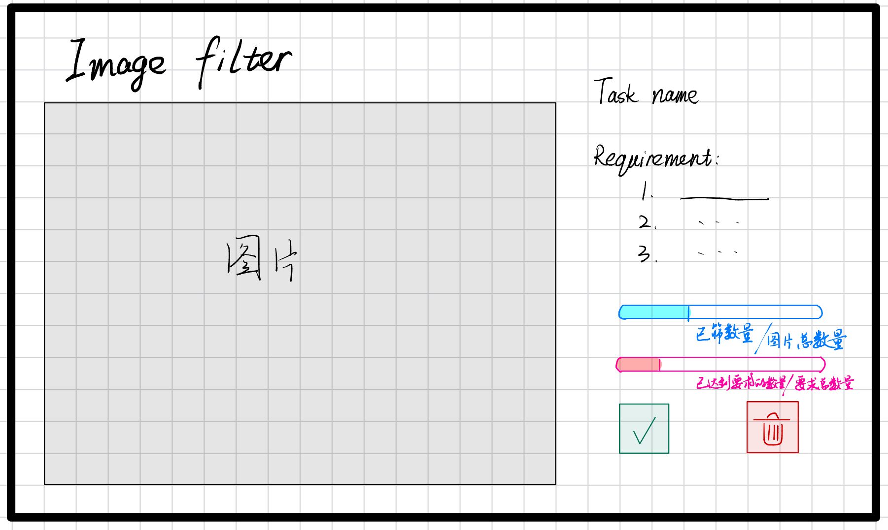

# Design

## 前端设计

前端界面设计如上图所示。

最上方是标题“Image Filter”

左边是待筛选的图片，右边栏是任务信息和筛选按钮

右边栏有3个部分：
1. 第1部分（最上方）是Task name和 这个任务对应的 Requirement，其中：
  - Task name：由用户输入，如果该任务不存在，就报错 “Task not found!”
  - Requirement：根据用户输入的Task name，在`./Layout_Requirement`目录下找到 以该Task name命名的 yaml 文件，将里面的 requirement下的内容 显示在这里。
2. 第2部分（中间）是2个进度条：
  - 上面的进度条是“筛选进度条”：已筛图片数量/该任务下的图片总数
  - 下面的进度条是“达标进度条”：已经达到要求的图片数量/总的达标数量 （总的达标数量从`./Layout_Requirement`目录下 以该Task name命名的 yaml 文件中的 target_count 决定）
3. 第3部分（下方）是两个按钮：
  - 绿色的打勾按钮：中间是一个勾图标。按下该按钮，表示该图片满足要求，“达标进度条”的进度+1，“筛选进度条”的进度+1；然后跳到下一张图片
  - 红色的删除按钮：中间是一个垃圾桶图标。按下该按钮，表示该图片不满足要求，“达标进度条”的进度不变，“筛选进度条”的进度+1；然后跳到下一张图片

左边的图片：根据 用户输入的 Task name ，在`./images/`目录下找到以该 Task name 命名的文件夹， 将里面的所有图片依次读取出来（注意：该 Task name 命名的文件夹下面可能还有嵌套文件夹，将里面的图片全部都依次读取出来），依次显示在左边。

除此之外，在`./images/`目录下每个以 Task name 命名的文件夹里维护一个 `progress.json`文件，里面记录目前已经筛选了哪些图片，哪些图片达标。这是为了当用户未完成一个任务的筛选就退出程序时，可以从该json文件中读取上一次的进度，然后就能继续该任务的筛选。

